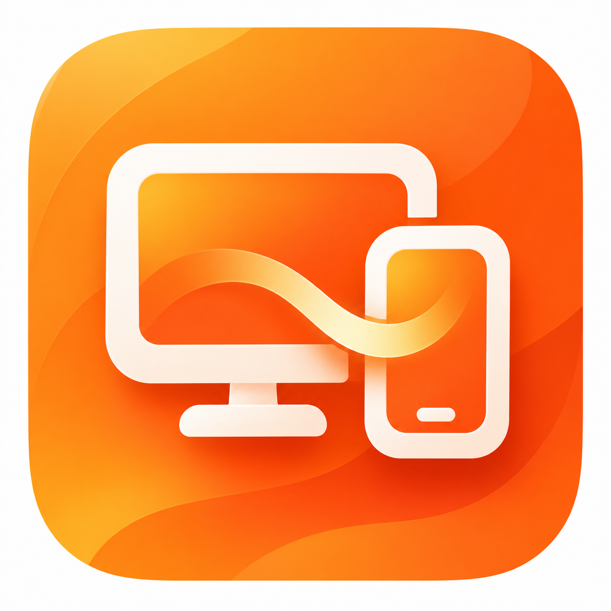

  

<h1 align="center">Weilian · 微连</h1>

<strong>Connect to your Android phone from a desktop browser.</strong>

  <a href="https://lianliankan.lgkj666.cn/downloads/orangelink.html"><strong>Download for Android</strong></a> ·
  <a href="https://lianliankan.lgkj666.cn/downloads/weilian-guide-v2/guide.html">Illustrated guide (Chinese)</a> ·
  <a href="README.md">简体中文</a>

Weilian lets you see your Android phone on a larger screen, type with your computer keyboard, and move photos or documents between the two devices. Install the app on your phone, then use a browser on the computer to connect.

## What you can do

| Task | How it works |
| --- | --- |
| **View your phone screen** | Approve Android's screen-sharing prompt. You can stop sharing from the phone at any time. |
| **Use your mouse and keyboard** | Click, swipe, and type from the browser after you grant the required permission on the phone. |
| **Transfer files both ways** | Send photos and documents from either device. Follow progress or cancel the transfer. |
| **Send a folder from your computer** | Select an entire folder and send it to the phone with its subfolders intact. |

## Get started

1. **Install and activate.** Open the [download page](https://lianliankan.lgkj666.cn/downloads/orangelink.html) on your Android phone. The commercial edition requires a valid activation code. Photo and file transfer availability depends on the permissions included with your code.
2. **Pair the devices.** Open the connection address shown in the app on your computer. Use Weilian on your phone to scan the browser's pairing QR code.
3. **Approve on your phone.** Review the connection and follow the prompts to share your screen. Enable Weilian's accessibility service only if you need remote input; it is not required for viewing the screen.

## Direct transfers and compatibility

- **Direct and relayed paths.** The service handles pairing, authorization, and connection setup. If a direct P2P path is available, file data bypasses the relay. Otherwise, the session can use an encrypted relay. Direct transfer is network-dependent and is not an offline mode.
- **Android.** The current public package supports ARM64 phones running Android 10 or later. There is no iOS package.
- **Desktop browser.** Start with a recent version of Chrome or Edge. Ordinary use does not require a desktop app, though some local-network transfers may use an optional helper.
- **Supported devices.** File transfer currently works between an Android phone and a desktop browser. Direct phone-to-phone transfer is under evaluation and is not in the current release.
- **Consent.** Connect only to devices you own or have explicit permission to access. Screen sharing and remote input require their own permissions on the phone.

## Feedback and releases

Use [GitHub Issues](https://github.com/wuhanwhite1979/weilian/issues) for feedback. Include your Weilian version, Android version, browser and steps to reproduce. For transfer issues, mention whether the devices were on the same Wi-Fi or on separate networks. Leave out activation codes, passwords, pairing QR codes, and private files.

This is the official product documentation repository. It does not contain the app, commercial backend source code, or APKs. For the current build, use the download page; see the [version notes](CHANGELOG.md) for the published version record.
