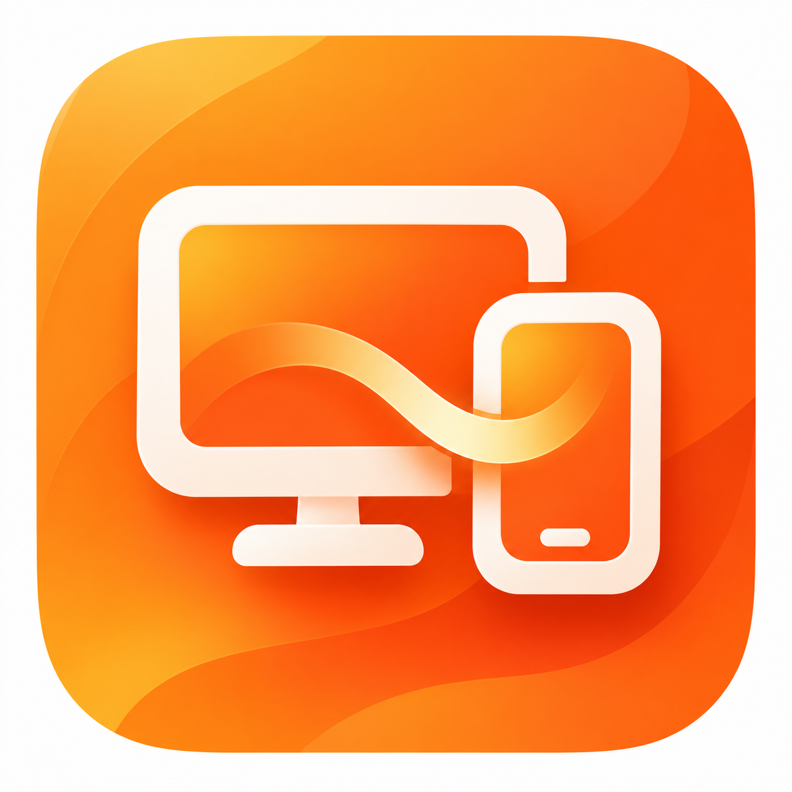

  

<h1 align="center">微连 · Weilian</h1>

<strong>用电脑浏览器连接你的 Android 手机。</strong>

  <a href="https://lianliankan.lgkj666.cn/downloads/orangelink.html"><strong>下载安卓版</strong></a> ·
  <a href="https://lianliankan.lgkj666.cn/downloads/weilian-guide-v2/guide.html">图文与视频指南</a> ·
  <a href="FAQ.md">常见问题</a> ·
  <a href="CHANGELOG.md">版本说明</a> ·
  <a href="README.en.md">English</a>

想在电脑大屏上查看手机画面、用键盘输入，或者把照片和文档在两边传来传去？微连只需在手机上安装 App。电脑端打开浏览器，手机扫码确认后即可开始。

## 能做什么

| 场景 | 怎么用 |
| --- | --- |
| **看手机画面** | 在手机确认系统共享提示后，电脑浏览器可以显示手机画面。随时可以在手机上结束共享。 |
| **用鼠标和键盘操作** | 获得手机端相应权限后，可以在浏览器里点击、滑动和输入文字。 |
| **手机与电脑双向传文件** | 图片、PDF、办公文档等可由任一端发起。传输时可查看进度，也可以取消。 |
| **从电脑发送文件夹** | 在电脑选中整个文件夹后发送到手机，可保留其中的子目录结构。 |

## 三步开始

1. **手机安装并激活。** 用 Android 手机打开[固定下载页](https://lianliankan.lgkj666.cn/downloads/orangelink.html)，下载安装微连。商业版需要有效卡密；图片和文件功能以该卡密开通的权限为准。
2. **电脑打开连接页。** 在电脑浏览器进入 App 提示的连接地址，使用手机微连扫描网页上的配对二维码。
3. **在手机上确认。** 核对连接后按提示开始共享。需要远程操作时，再在手机设置中开启微连的无障碍服务；只查看画面无需启用该操作权限。

想跟着界面一步步做？见[官方图文与视频指南](https://lianliankan.lgkj666.cn/downloads/weilian-guide-v2/guide.html)。

## 文件直连怎么工作？

服务端负责配对、授权和连接协商。网络允许时，文件可通过 P2P 在手机与电脑之间直接传输，文件数据不经中继；直连未建立时，会话可使用加密中继。直连是否成功取决于两端网络和浏览器环境，不等于离线可用，也不代表每次传输都走直连。

## 兼容性与边界

- **手机端：** 当前公开安装包面向 Android 10 及以上的 ARM64 手机，无 iOS 安装包。
- **电脑端：** 优先使用新版 Chrome 或 Edge。通常直接用浏览器即可；部分局域网传输场景可能要按页面提示使用辅助工具。
- **文件互传：** 用于已连接的 Android 手机 ↔ 电脑浏览器，不是离线云盘。两台手机直接互传是正在评估的方向，当前版本暂未提供。
- **授权：** 只连接本人设备或已取得使用者明确同意的设备。扫码配对不等于自动获得屏幕共享或操作权限；这些权限由手机端确认。

## 反馈与版本

在 [GitHub Issues](https://github.com/wuhanwhite1979/weilian/issues) 反馈时，请附上微连版本、Android 版本、电脑浏览器，以及复现步骤。如果是传输问题，可以再注明是同一 Wi-Fi 还是异地网络。请勿附上卡密、密码、配对二维码或私人文件。

这里是**官方产品介绍与使用文档仓库**，不含 App、商业后端源码或 APK。当前安装版本请以固定下载页为准，历史信息见[版本说明](CHANGELOG.md)。
